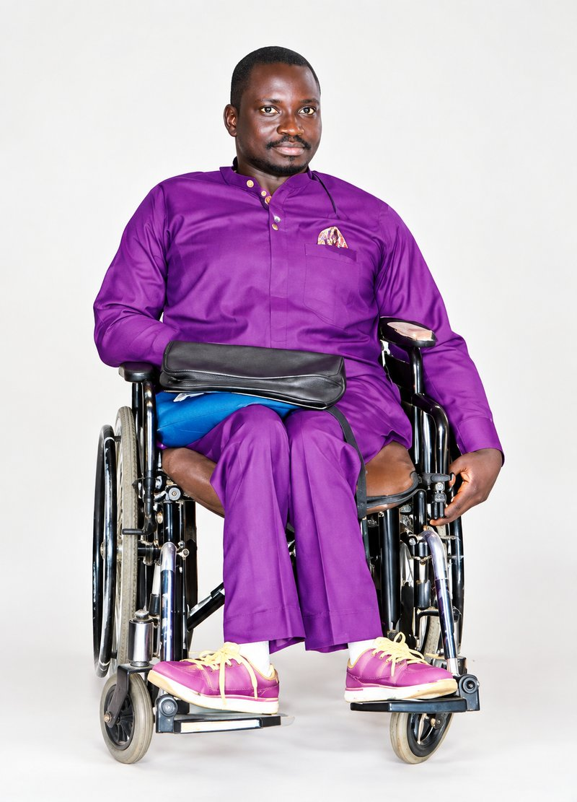

::: {.creed}
**Statistics without AI taught me why. Statistics with AI taught me how fast.**

I fuse both — my ideas, AI's implementation — and I am a transhumanist about
where that leads.
:::

<nav class="layer-nav" aria-label="Sections of this page">
[Education](#education-and-honours)
[Work](#selected-work)
[Toolbox](#toolbox)
[Areas](#areas-i-work-in)
[Chess](#chess)
[Contact](#getting-in-touch)
</nav>

I am a statistician at Abubakar Tafawa Balewa University in Bauchi, Nigeria, where
I am a Senior Statistician in the Academic Planning & Quality Assurance unit —
building the institutional databases that sixty-odd departments report into, and
advising the research projects that pass through them. Since 2017 I have also run
JJMB Datascience Hub, an independent consultancy doing much the same
work for clients in public health, finance and academia.

I am currently a PhD student in Statistics at ATBU, working on hybrid Bayesian deep learning for spatio-temporal risk forecasting. My MSc is also from ATBU and my BSc from the University of Maiduguri,
finishing in at least the top two of my class in both instances. I put it that way
on purpose. I am strongly against the GPA system: it compresses years of uneven and
largely incomparable work into one number, and then invites everybody to treat that
number as a finding rather than as the very lossy summary it is. Rank is the least
misleading version I can give, and the actual evidence is the work — the posts here
and [my projects](projects.qmd).

The methods I reach for most are Bayesian inference, survival analysis, spatial and
geo-additive modelling, and time series forecasting — usually on survey or health
data, where the answer worth reporting is an interval rather than a number. The
fuller range is below.

This site is where I check that work instead of assuming it. A simulation that
disagrees with what I expected is the most useful thing I can publish, so most of
what is here is written to be run again rather than read once.

<figure class="portrait">

<figcaption>Jerry Zachary Bannister, Bauchi State, Nigeria.</figcaption>
</figure>

## Education and honours

**PhD Statistics, Abubakar Tafawa Balewa University** (2026–present) — in progress:
hybrid Bayesian deep learning for spatio-temporal risk forecasting.

**MSc Statistics, ATBU** (2024) — best in class, top 1%. Thesis *Close-Knit
Regression*, supervised by Prof. A. Abdulkadir.

**BSc Statistics, University of Maiduguri** (2013) — second best in class, top 2%. Undergraduate project *M/M/c queuing analysis of automated teller machines at Fidelity Bank, Maiduguri*, supervised by Prof. Haruna Rann Bakari.

**MTN Foundation Scholarship** (2009–2012), with a place on the Dean's List every
year of that period; commendation from ATBU's Directorate of Academic Planning
(2021). Registered Statistician, CISON (member ID 20260732), since September 2026.

Seven peer-reviewed papers in health and applied statistics —
[Google Scholar](https://scholar.google.com/citations?user=oKaejtMAAAAJ) ·
[ORCID](https://orcid.org/0009-0002-3302-9558).

## Selected work

- **[Tobacco price intelligence](https://github.com/batestguy/tobacco-price-intelligence)** — XGBoost demand forecast at 10.9% MAPE against a 13.8% naive baseline; fine-tuned FinBERT at 76.8% against a 71.0% majority class.
- **[Crude blend optimizer](https://github.com/batestguy/dangote-refinery-optimizer)** — yield surrogates at R² ≥ 0.982 drive differential evolution to within $0.005/bbl of the exact LP optimum, with VaR/CVaR over 10,000 price scenarios.
- **[Disability rights assistant](https://github.com/batestguy/NGOdisabilityRAG)** — quotes the 2018 Act and the Constitution word for word with a citation on every excerpt; held-out strict recall 0.63–0.65, zero false refusals, WCAG 2.2 AA with no axe violations across 33 views.
- **[Urban agriculture, where it concentrates](https://github.com/batestguy/urban-agriculture-nigeria-spatial)** — Moran's I = 0.300 across 775 LGAs, only 19 significant after FDR control; density falls 66% per doubling of area, and the effect survives an explicit control for uneven OpenStreetMap coverage (ΔAIC ≈ 20).
- **[curb-cut](https://github.com/batestguy/curb-cut)** — arcsine Fay–Herriot small-area estimates of adult disability prevalence, with a bias-corrected back-transform and a parametric-bootstrap MSE.

## Toolbox

- **Languages** — Python · R · SQL · TypeScript/JavaScript
- **Statistics and ML** — PyMC, scikit-learn, XGBoost, TensorFlow/Keras, SciPy optimisation, survival, spatial and time-series models
- **Apps and reporting** — Quarto, Shiny, Streamlit, Gradio, React, Tableau, Power BI
- **Engineering** — Git, GitHub Actions, Docker, Supabase, Cloudflare Pages, Render
- **Accessibility** — WCAG 2.2 AA, keyboard navigation, screen-reader layouts, axe audits

## Areas I work in

A map of the ground, not a claim to have covered all of it. Where something here
has a post behind it, the post is the evidence; where it does not, read it as
interest rather than track record. Each domain opens only if you want it.

Statisticsinference, Bayesian, regression, survival, time series, spatial, causal

- **Foundations** — probability and distribution theory, asymptotics, estimation theory (maximum likelihood, moments, M-estimation), sufficiency, information and decision theory
- **Inference** — hypothesis tests, confidence and credible intervals, likelihood-ratio/Wald/score, power and sample size, multiple comparisons and FDR, equivalence testing
- **Bayesian** — priors, elicitation and conjugate analysis, MCMC (Metropolis–Hastings, Gibbs, HMC/NUTS), variational inference, ABC, hierarchical and multilevel models, posterior predictive checks, LOO-CV, WAIC, Bayes factors, model averaging
- **Regression** — linear, GLM, GAM, mixed-effects and GLMM, quantile, robust, ridge/lasso/elastic net, splines, nonlinear regression, overdispersion; logistic, ordinal and multinomial; Poisson, negative binomial, zero-inflated and hurdle models
- **Survival** — Kaplan–Meier, log-rank, Cox, parametric AFT, competing risks, frailty, time-varying covariates, recurrent events, joint longitudinal–survival models
- **Time series** — ARIMA/SARIMA/ARIMAX, exponential smoothing, state-space and Kalman filtering, structural time series, VAR/VECM and cointegration, GARCH, spectral analysis, change-point detection, probabilistic forecasting and backtesting
- **Spatial** — geostatistics and kriging, variograms, CAR and SAR, INLA, point processes, geo-additive models, disease mapping, small-area estimation
- **Multivariate** — PCA, factor analysis, canonical correlation, discriminant analysis, MANOVA, cluster analysis, multidimensional scaling, correspondence analysis, SEM
- **Causal inference** — potential outcomes, DAGs and do-calculus, propensity scores and matching, inverse probability weighting, doubly robust estimation, instrumental variables, regression discontinuity, difference-in-differences, synthetic control, mediation, sensitivity analysis
- **Design and surveys** — RCTs, factorial and fractional factorial, blocking, split-plot, crossover, response surface, optimal design, A/B and sequential designs; sampling designs, stratification and clustering, complex weighting, raking, non-response, design-based variance, questionnaire design
- **Missing data and resampling** — MCAR/MAR/MNAR, multiple imputation, EM, weighting, sensitivity analysis; bootstrap, jackknife, permutation tests, cross-validation, Monte Carlo, simulation study design
- **Nonparametrics and applied fields** — rank-based tests, kernel density estimation, nonparametric regression, empirical likelihood; biostatistics and epidemiology, econometrics and panel data, psychometrics and IRT, reliability and extreme values, statistical process control, meta-analysis, demography, actuarial and risk modelling
- **Specialised data** — compositional, functional data analysis, directional and circular statistics, network data, longitudinal and panel data

Machine learningsupervised, ensembles, unsupervised, probabilistic, interpretability, MLOps

- **Supervised and ensembles** — linear and logistic regression, k-NN, naive Bayes, SVM, discriminant analysis, decision trees; bagging, random forests, extra trees, gradient boosting (XGBoost, LightGBM, CatBoost), AdaBoost, stacking and blending
- **Unsupervised and representation** — k-means, hierarchical clustering, DBSCAN/HDBSCAN, Gaussian mixtures, spectral clustering, association rules; PCA and kernel PCA, ICA, NMF, t-SNE, UMAP, autoencoders, manifold learning, learned embeddings
- **Probabilistic ML** — Gaussian processes, Bayesian optimisation, probabilistic graphical models, Bayesian networks, hidden Markov models, Markov random fields
- **Model development** — feature engineering and selection, encoding strategies, pipelines, hyperparameter search (grid, random, Bayesian, Optuna), nested cross-validation, learning curves
- **Uncertainty and hard cases** — probability calibration, conformal prediction, prediction intervals; class imbalance (SMOTE, cost-sensitive learning), concept drift, distribution shift, small-sample regimes, censored targets
- **Interpretability** — SHAP, LIME, partial dependence and ICE, permutation importance, counterfactuals, surrogate models
- **Other paradigms** — semi-supervised, self-supervised, active, online and streaming, transfer, multi-task, meta- and federated learning; bandits, MDPs, Q-learning, policy gradients, actor–critic, offline RL
- **Specialised systems** — recommenders (collaborative filtering, matrix factorisation, hybrid), learning to rank, anomaly and fraud detection, survival ML, uplift modelling, forecasting at scale
- **Responsible ML and MLOps** — fairness metrics, bias auditing, differential privacy, model governance, reproducibility; experiment tracking, model registries, feature stores, containerised deployment, batch and real-time serving, drift monitoring, CI/CD, shadow and A/B deployment

Deep learningvision, transformers and LLMs, generative, graphs, efficiency

- **Fundamentals** — backpropagation, activation and loss design, initialisation, optimisers (SGD, momentum, RMSProp, Adam/AdamW), learning-rate schedules, batch/layer/group normalisation, dropout, weight decay, early stopping, gradient clipping, mixed precision
- **Vision** — CNNs, ResNet, DenseNet, EfficientNet; detection (YOLO, Faster R-CNN, DETR); segmentation (U-Net, Mask R-CNN); augmentation; vision transformers
- **Sequence and attention** — RNN, LSTM, GRU, sequence-to-sequence, attention mechanisms, temporal convolutional networks
- **Transformers and NLP** — BERT, GPT, T5, tokenisation, embeddings and vector search, NER, text classification, summarisation, translation, question answering
- **Large language models** — pretraining, supervised and parameter-efficient fine-tuning (LoRA, QLoRA), instruction tuning, RLHF and DPO, prompt engineering, retrieval-augmented generation, evaluation and hallucination measurement, quantisation, distillation, agentic workflows and guardrails
- **Generative and graphs** — VAEs, GANs, diffusion models, normalising flows, autoregressive generation; GCN, GraphSAGE, graph attention networks, node classification and link prediction
- **Deep forecasting and scientific ML** — DeepAR, N-BEATS, N-HiTS, temporal fusion transformers, probabilistic deep forecasting; PINNs, neural ODEs, operator learning, surrogate modelling
- **Uncertainty and multimodal** — Bayesian neural networks, Monte Carlo dropout, deep ensembles, evidential learning, classifier calibration; contrastive learning (SimCLR, MoCo), CLIP, masked modelling, speech and ASR, vision-language models
- **Adaptation, efficiency and interpretability** — transfer learning, fine-tuning, domain adaptation, few- and zero-shot, curriculum learning; pruning, quantisation, distillation, ONNX and TensorRT, edge inference, distributed GPU training; saliency maps, Grad-CAM, integrated gradients, attention visualisation, probing, mechanistic interpretability

## Chess

I play as `BayesianRules` on both [Chess.com](https://www.chess.com/member/BayesianRules)
and [Lichess](https://lichess.org/@/BayesianRules), with a rapid peak of 2011 on Chess.com and a blitz peak of 2072 on Lichess. It is the one place I get to reason about an opponent's
uncertainty rather than a distribution's, which turns out to be less of a change
of subject than it sounds.

## Getting in touch

::: {.contact-card}
[batesthommie@gmail.com](mailto:batesthommie@gmail.com)\
[+234 706 167 4831](tel:+2347061674831)\
Bauchi State, Nigeria
:::

Consulting enquiries, collaborations, and questions about anything here are all
welcome by email. Corrections especially — particularly the ones that show a
simulation here was set up wrong. Those can go by email too, or as an issue on
[the repository](https://github.com/batestguy/QuartoWebsite-blog-others/issues) if
you would rather they were public.
