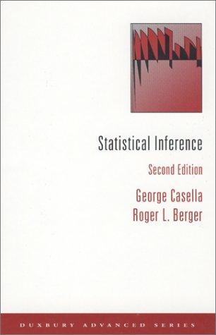
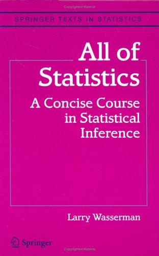
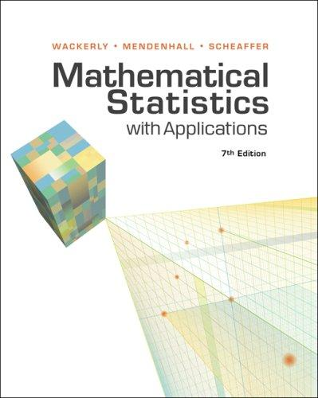

<!--
Covers are vendored into images/books/ by ISBN, never hotlinked, per CLAUDE.md
on site assets. Fetched from the Open Library covers API and checked by eye
against the editions named below before being committed — a wrong edition on a
page about rigour is worse than no image. Styles: .book-shelf in
theme/_post-components.scss.
-->

  <figure>
    
    <figcaption><cite>Statistical Inference</cite> (2nd ed.) Casella &amp; Berger</figcaption>
  </figure>
  <figure>
    
    <figcaption><cite>All of Statistics</cite> Larry Wasserman</figcaption>
  </figure>
  <figure>
    
    <figcaption><cite>Mathematical Statistics with Applications</cite> (7th ed.) Wackerly, Mendenhall &amp; Scheaffer</figcaption>
  </figure>

The texts are Casella &amp; Berger's *Statistical Inference*, Wasserman's *All of
Statistics* and Wackerly, Mendenhall &amp; Scheaffer's *Mathematical Statistics
with Applications* — a course text, a concise graduate tour, and the applied
standard, which between them cover most of where a derivation goes wrong.

Standard texts are often precise at the cost of being unreadable. These posts
take one topic at a time and rewrite it: plain statement first, simulation
where a simulation makes the point better than an algebraic derivation, and the
derivation kept only where it is genuinely the shortest route.
