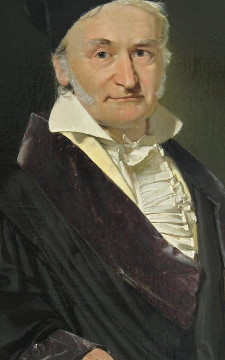

<figure class="portrait-inline">

<figcaption>Carl Friedrich Gauss, 1840, by Christian Albrecht Jensen. Public domain, via Wikimedia Commons. Cropped to a portrait, nothing else altered.</figcaption>
</figure>

```{r}
#| label: se-bands
#| include: false

# ---- Every number in the table comes from here ------------------------------
#
# Two seeds, deliberately: one fixing the single sample in bands 2 and 3, one
# fixing the 100,000 replicates in bands 4 and 6. Both are set in advance, so
# the printed values are stable across renders without anything being typed.
#
# Band 1 is arithmetic on the truth about one measurement, in centimetres.
# Bands 2 to 5 are the proof. Band 6 checks it, and band 7 is what a reader
# does with the number afterwards: scaling, the plug-in, the bootstrap, and
# coverage. Nothing in bands 2 to 5 depends on either.

fmt <- function(x) format(x, digits = 4, scientific = FALSE)

mu    <- 5     # L1
sigma <- 1.3   # L2
n     <- 25    # L3

# Bands 2 and 3: one sample, and the square of its deviations split into
# diagonal and cross blocks.
set.seed(7)
x <- rnorm(n, mu, sigma)   # L4
z <- x - mu                # L5

M           <- outer(z, z)          # L6, all n^2 products
diag_block  <- sum(diag(M))         # L7, the n squares
cross_block <- sum(M) - diag_block  # L8, the n(n-1) crosses
term_count  <- n + n * (n - 1)      # L9

# Band 4: the same experiment 100,000 times, to take the expectation of each
# block. Centring the whole matrix at once is (4.1) applied to every row.
set.seed(11)
N <- 1e5
S <- matrix(rnorm(N * n, mu, sigma), N, n) - mu    # L10

diag_draws  <- rowSums(S^2)               # per-sample diagonal block
cross_draws <- rowSums(S)^2 - diag_draws  # per-sample cross block

m_diag    <- mean(diag_draws)             # L11
se_diag   <- sd(diag_draws) / sqrt(N)
m_cross   <- mean(cross_draws)            # L12
se_cross  <- sd(cross_draws) / sqrt(N)

# Bands 5 and 6.
var_mean <- (1 / n^2) * (n * sigma^2)     # L14, exact
se_exact <- sigma / sqrt(n)               # L15, exact

set.seed(11)
means <- replicate(N, mean(rnorm(n, mu, sigma)))   # L16
var_means <- var(means)                            # L17
sd_means  <- sd(means)                             # L18

# Band 7: what the number is for. None of this feeds back into the proof.
sizes <- c(n, 4 * n, 16 * n)              # L19
N_scale <- 2e4   # fewer repeats here: each one now costs up to 16x the draws

set.seed(11)
sd_sizes <- sapply(sizes, function(k) sd(replicate(N_scale, mean(rnorm(k, mu, sigma)))))   # L20

se_hat <- sd(x) / sqrt(n)                 # L21, sigma replaced by the sample's s

set.seed(11)
boot <- replicate(N, mean(sample(x, replace = TRUE)))   # L22, resample the held sample
sd_boot <- sd(boot)                                     # L23

cover <- mean(abs(means - mu) <= 1.96 * se_exact)       # L24, uses band 6's means
```

## Claim

Casella and Berger prove $\operatorname{Var}(\bar X)=\sigma^2/n$ — Theorem 5.2.6(b), p. 214 — and stop there. The standard error is its square root.

The proof is one idea. Square the deviation, expand the square into $n^2$ terms, take the expectation of each: the $n$ diagonal terms each expect $\sigma^2$, independence kills all $n(n-1)$ cross terms, and $n\sigma^2/n^2$ cancels once to $\sigma^2/n$. Nothing is estimated and no distribution is assumed.

## Code, maths, English

::: {.transition}
| Code | Maths | English |
|:--|:--|:--|
| **BAND 1 — the three numbers** | | |
| **L1 ↔ (1.1)** `mu <- 5` | (1.1) $\mu := 5$ | A definition, not a measurement; `<-` and $:=$ say the same thing in two alphabets. |
| **L2 ↔ (1.2)** `sigma <- 1.3` | (1.2) $\sigma := 1.3,\quad\sigma^2 = `r fmt(sigma^2)`$ | `r fmt(sigma)` cm of spread per measurement; `r fmt(sigma^2)` is the same fact in cm². The square root between them is the whole post. |
| **L3 ↔ (1.3)** `n <- 25` | (1.3) $n := 25$ | How many measurements — fixed by design, estimated from nothing. |
| **BAND 2 — one sample, and its deviations** | | |
| **L4 ↔ (2.1)** `x <- rnorm(n, mu, sigma)` | (2.1) $X_1,\dots,X_n \overset{\text{iid}}{\sim} N(\mu,\sigma^2)$ | `r n` draws. The normal supplies independent numbers, nothing more: no later line uses its shape. |
| **L5 ↔ (2.2)** `z <- x - mu` | (2.2) $z_i := X_i - \mu,\qquad E[z_i] = 0$ | Centre on the **truth**, not on `mean(x)`. After this line $\mu$ is gone, which is why every later step is short. |
| **BAND 3 — the square splits into two blocks** | | |
| **L6 ↔ (3.1)** `M <- outer(z, z)` | (3.1) $\Big(\sum_i z_i\Big)^2 = \sum_i z_i^2 + \sum_{i\ne j} z_i z_j$ | Every product of two deviations — all `r fmt(n^2)` — in one `r n`×`r n` matrix. |
| **L7 ↔ (3.2)** `sum(diag(M))` | (3.2) $\sum_i z_i^2 \quad$ — $n$ diagonal terms | prints `r fmt(diag_block)`, *this* sample's block. Band 4 prints a different number and both are correct. |
| **L8 ↔ (3.3)** `sum(M) - sum(diag(M))` | (3.3) $\sum_{i\ne j} z_i z_j \quad$ — $n(n-1)$ cross terms | prints `r fmt(cross_block)`; the two blocks together are `r fmt(diag_block + cross_block)` $=(\sum z_i)^2$. Exact, not approximate. |
| **L9 ↔ (3.4)** `n + n * (n - 1)` | (3.4) $n + n(n-1) = n^2$ | prints `r fmt(term_count)`, matching the matrix's `r fmt(n^2)` cells: $n$ squares, $n(n-1)$ crosses, nothing else. |
| **BAND 4 — take the expectation of each block** | | |
| **L10 ↔ (4.1)** `S <- matrix(rnorm(N * n, mu, sigma), N, n) - mu` | (4.1) $N$ independent samples of size $n$, each centred the same way | `r format(N, big.mark = ",", scientific = FALSE)` repeats of band 2. That is what an expectation is when you compute it: the same experiment, averaged. |
| **L11 ↔ (4.2)** `mean(rowSums(S^2))` | (4.2) $E\Big[\sum_i z_i^2\Big] = n\sigma^2$ | prints `r fmt(m_diag)` ± `r fmt(se_diag)` against $n\sigma^2 = `r fmt(n * sigma^2)`$. **L7's `r fmt(diag_block)` was not an error**: one sample varies, the average does not. |
| **L12 ↔ (4.3)** `mean(rowSums(S)^2 - rowSums(S^2))` | (4.3) $E[z_iz_j] = \operatorname{Cov}(X_i,X_j) = 0,\quad i \ne j$ | prints `r fmt(m_cross)` ± `r fmt(se_cross)` against an exact 0: zero plus noise. This line is where independence is used; make the block a covariance and the answer is no longer $\sigma^2/n$. |
| **L13 ↔ (4.4)** `n * sigma^2` | (4.4) $n\sigma^2 = `r fmt(n * sigma^2)`$ | What L11 was aiming at. No draws, no noise — the algebra, before any data exists. |
| **BAND 5 — add the blocks, divide by $n^2$, then root** | | |
| **L14 ↔ (5.1)** `(1 / n^2) * (n * sigma^2)` | (5.1) $\operatorname{Var}(\bar X) = \dfrac{1}{n^2}\,n\sigma^2 = \dfrac{\sigma^2}{n}$ | prints `r fmt(var_mean)` in **cm²**: $n\sigma^2 + 0$ over $n^2$, and one $n$ cancels. That cancellation is Theorem 5.2.6(b). |
| **L15 ↔ (5.2)** `sigma / sqrt(n)` | (5.2) $\operatorname{SE}(\bar X) = \dfrac{\sigma}{\sqrt n}$ | prints `r fmt(se_exact)` in **cm**. Not interchangeable with (5.1): one is the other squared, and the units say so. |
| **BAND 6 — check the finished result by simulation** | | |
| **L16 ↔ (6.1)** `means <- replicate(N, mean(rnorm(n, mu, sigma)))` | (6.1) $\bar X_1,\dots,\bar X_N$ from $N$ independent samples | `r format(N, big.mark = ",", scientific = FALSE)` averages of `r n` fresh measurements: the experiment the theorem predicts, run that many times. |
| **L17 ↔ (6.2)** `var(means)` | (6.2) $\operatorname{Var}(\bar X) \approx \widehat{\operatorname{var}}\big(\{\bar X_k\}\big)$ | prints `r fmt(var_means)` against the exact `r fmt(sigma^2 / n)`, ratio `r fmt(var_means / (sigma^2 / n))`: the averages land on (5.1). |
| **L18 ↔ (6.3)** `sd(means)` | (6.3) $\operatorname{SE}(\bar X) \approx \widehat{\operatorname{sd}}\big(\{\bar X_k\}\big)$ | prints `r fmt(sd_means)` against `r fmt(se_exact)`. Rooting L17 or taking the spread of the means gives the same number to three digits. |
| **BAND 7 — what the number is for** | | |
| **L19 ↔ (7.1)** `sizes <- c(n, 4 * n, 16 * n)` | (7.1) $\operatorname{SE}(\bar X_n) = \dfrac{\sigma}{\sqrt n}$, so $\operatorname{SE}_{4n} = \tfrac12 \operatorname{SE}_n$ and $\operatorname{SE}_{16n} = \tfrac14 \operatorname{SE}_n$ | No new derivation: the $\sqrt n$ from (5.2) is simply read at $n$, $4n$ and $16n$. This is the first question anyone asks after seeing the formula — how much does more data buy? |
| **L20 ↔ (7.2)** `sd_sizes <- sapply(sizes, ...)` | (7.2) $\widehat{\operatorname{SE}}$ at each of the three sizes | prints `r fmt(sd_sizes[1])`, `r fmt(sd_sizes[2])`, `r fmt(sd_sizes[3])` against `r fmt(se_exact)`, `r fmt(se_exact / 2)`, `r fmt(se_exact / 4)`. Quadruple the sample and the error halves: `r fmt(sd_sizes[1] / sd_sizes[2])` against a predicted 2. Sixteen times the data buys a quarter of the error, not a sixteenth — `r fmt(sd_sizes[1] / sd_sizes[3])` against a predicted 4 — so to halve it again you must quadruple again. Precision is bought with a square root, and that is the bill. |
| **L21 ↔ (7.3)** `se_hat <- sd(x) / sqrt(n)` | (7.3) $\widehat{\operatorname{SE}} = \dfrac{s}{\sqrt n}$, where $s^2 = \frac{1}{n-1}\sum_i (X_i - \bar X)^2$ | $\sigma$ is never actually known, so $s$ — the spread of the sample from band 2 — goes in its place. Prints `r fmt(se_hat)` against the true `r fmt(se_exact)`. The gap is not a bug: that sample's $s$ is `r fmt(sd(x))` cm against $\sigma = `r fmt(sigma)`$, so this sample's honest error bar really is wider than the truth's would be. Two numbers, both correct, answering different questions — and band 3 already showed you why this sample is the wide one. |
| **L22 ↔ (7.4)** `boot <- replicate(N, mean(sample(x, replace = TRUE)))` | (7.4) $X^*_1, \dots, X^*_n$ drawn with replacement from $x$ | Efron's route: no formula, no $\sigma$, no imagined fresh data. Resample the twenty-five numbers you already hold, `r format(N, big.mark = ",", scientific = FALSE)` times, and keep each average. |
| **L23 ↔ (7.5)** `sd(boot)` | (7.5) $\sqrt{\dfrac{n-1}{n}} \cdot \dfrac{s}{\sqrt n}$ | prints `r fmt(sd_boot)` against `r fmt(sqrt((n - 1) / n) * se_hat)` from (7.3) — ratio `r fmt(sd_boot / se_hat)`, which is $\sqrt{24/25} = `r fmt(sqrt((n - 1) / n))`$ to four digits. The bootstrap reproduces the plug-in without doing the algebra, and is low by exactly that finite-sample factor. Same answer, different road, and the roads do not quite meet. |
| **L24 ↔ (7.6)** `mean(abs(means - mu) <= 1.96 * se_exact)` | (7.6) $\Pr\big(\lvert \bar X - \mu \rvert \le 1.96\,\sigma/\sqrt n\big) \approx 0.95$ | prints `r fmt(100 * cover)` per cent. **Not** the derivation: a distance becomes a probability only once the shape of the scatter is known, which §5.3 and §5.5 supply and §5.2 does not. The check also has to borrow `means` from band 6, because one sample cannot demonstrate coverage on its own. |
:::

::: {.callout-note collapse="true"}
## Where this comes from

**The derivation.** Casella & Berger, *Statistical Inference*, 2nd ed., §5.2. Lemma 5.2.5 (p. 213) states $\operatorname{Var}\big(\sum g(X_i)\big)=n\operatorname{Var}g(X_1)$; its proof writes the variance as the expectation of a squared sum and counts $n$ diagonal and $n(n-1)$ cross terms. Theorem 4.5.5 makes each cross term a covariance; independence makes it zero. Theorem 5.2.6(b) (p. 214) takes $g(x)=x/n$, giving $\operatorname{Var}(\bar X)=n\cdot\sigma^2/n^2=\sigma^2/n$. Bands 2 to 5 are that proof with the expectations written out instead of cited, so that L12 is visibly the step where independence enters and nowhere else.

**The name.** §5.2 stops at the variance. The words "standard error" do not occur until §10.1.4, "Bootstrap Standard Errors", p. 478. Taking the square root — (5.2) — is the step every applied text adds and this one does not.

**The bootstrap.** Efron, B. (1979), "Bootstrap methods: another look at the jackknife", *Annals of Statistics* 7(1), 1–26. For the mean, the variance of the resampling distribution is exactly $\frac{n-1}{n}\cdot\frac{s^2}{n}$, not approximately so, which is where the $\sqrt{(n-1)/n}$ in (7.5) comes from and why band 7 can predict the bootstrap's shortfall before running it.

**The code.** One chunk, `include: false`, labelled `se-bands`. Every number in the table is pulled from it as an inline `r` expression formatted to four significant figures; none is typed. `set.seed(7)` fixes the single sample in bands 2, 3 and 7, and `set.seed(11)` the `r format(N, big.mark = ",", scientific = FALSE)` replicates in bands 4, 6 and 7, so the printed values are stable across renders. The scaling check in (7.2) uses `N_scale <- 2e4` rather than `N`, because each of its repeats draws up to sixteen times as many numbers for a claim that is only a ratio; 20,000 repeats pin the ratio to three digits at a tenth of the cost.

**About the sample in band 3.** It is not typical, and it is not tuned. `r fmt(diag_block)` against an expectation of `r fmt(m_diag)` is roughly two standard deviations high. That gap is left in deliberately: it is the cleanest instance available of the difference between a realisation and its expectation, and a reader who has just seen both numbers in adjacent bands will not confuse them in band 5. The same wide sample is why the plug-in at (7.3) reads `r fmt(se_hat)` where the truth is `r fmt(se_exact)`.

**The photograph.** Carl Friedrich Gauss, 1840, by Christian Albrecht Jensen. A faithful photographic reproduction of a two-dimensional public-domain work; the artist died in 1870, and the painting is public domain in its country of origin and in the United States. Via Wikimedia Commons; cropped to a portrait, nothing else altered.
:::
