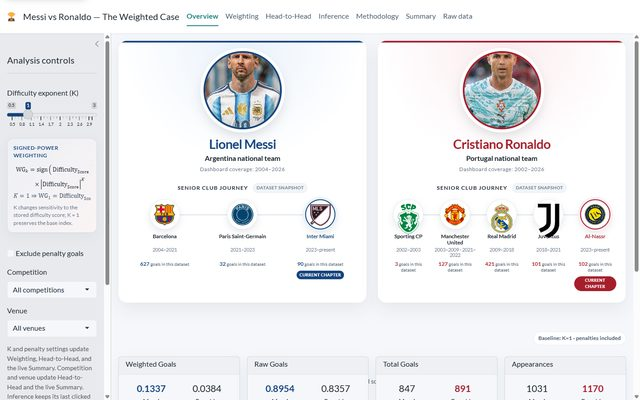
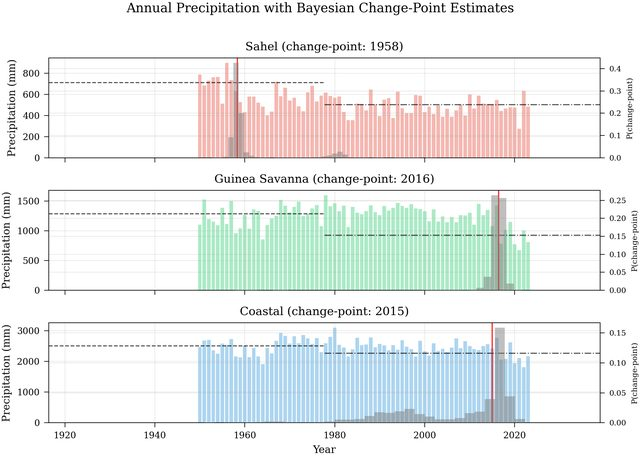
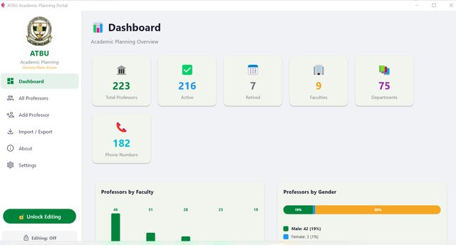
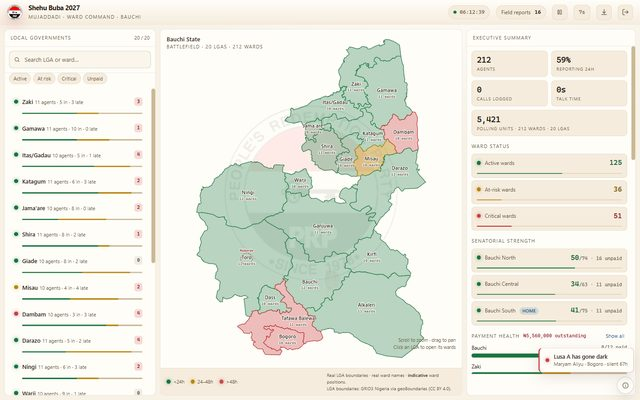
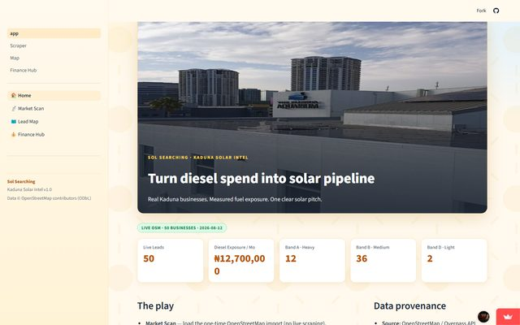
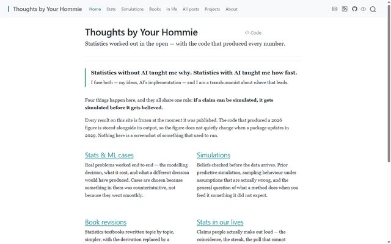

The posts on this site are arguments. These are artifacts: code that someone
other than me runs, or was built to be handed over. Each one links to its source.

Where a project produced a result, the result is stated here rather than
implied — including where the answer was less clean than I wanted.

<!--
Thumbnails are screenshots of the actual work: the running app, or the real
output figure the project produces. Not decoration, and not generated cards —
a reader should see the thing itself. Sources, so they can be regenerated:

  messi-vs-ronaldo      the live shinyapps.io dashboard
  rainfall-changepoint  figures/fig2_changepoint_timeseries.png in that repo
  prp-command-center    prp-command-center.html, demo login, rendered locally
  kaduna-solar          the live streamlit.app deployment
  this-website          _site/index.html from a local build
  atbu-portal           screenshots/dashboard.png in that repo

Vendored, never hotlinked, and resized to 640 px wide at JPEG q82 — ~35-50 KB
each against source screenshots of 100-250 KB. See CLAUDE.md on page weight.

Each entry keeps its heading OUTSIDE the grid so anchors and the TOC behave
exactly as before, and the grid collapses to one column on a phone. No theme/
change was needed: .grid and .g-col-* are Bootstrap classes Quarto ships.

STILL ON PLACEHOLDER CARDS (no screenshot yet): soccer-euro-sa, silman-anki.
Both need code executed to produce the artifact. See the note in CLAUDE.local.md.
-->

## Research and modelling

### [Messi vs Ronaldo — the weighted case](https://github.com/batestguy/messi-vs-ronaldo-r)

::: {.grid}
::: {.g-col-12 .g-col-md-3}
{fig-alt="The dashboard's overview tab, with Messi and Ronaldo side by side above their club histories, and metric cards giving weighted goals per 90 of 0.1337 against 0.0384."}
:::
::: {.g-col-12 .g-col-md-9}
An R Shiny dashboard that compares the two on **difficulty-adjusted** scoring
rather than raw totals. Opponent Elo, venue, competition stage and away status
are compressed into one difficulty score by a single global FAMD, and goals are
weighted by it. The denominator is every valid minute — 2,201 appearances and
181,081 minutes, with all 1,063 scoreless appearances kept in, which is where
most comparisons quietly cheat.

The result is the reason the project is worth reading. On the weighted index per
90 the gap is **+0.0953 in Messi's favour** (0.1337 against 0.0384), and a seeded
10,000-resample match bootstrap puts **96% of resampled differences above zero**
— but the 95% percentile interval is **[−0.0120, +0.1999]**, which crosses it.
The dashboard reports both numbers side by side and refuses to print a
significance verdict or a winner badge. Cohen's *d* is +0.090.

It is a fixed 2002–2026 research snapshot, not a live feed of career totals, and
the limitations section says so in seven bullets. Runs from a precomputed bundle
rather than scraping at startup; the container is pinned by digest and runs
non-root.

**[Open the live dashboard](https://qqxot9-batest-hommie.shinyapps.io/messi-vs-ronaldo-r/)**
:::
:::

### [Bayesian Change-Point Detection in Nigerian Rainfall](https://github.com/batestguy/Bayesian-Change-Point-Detection-in-Nigerian-Rainfall-Patterns-A-Hierarchical-Analysis-Climate-Zones)

::: {.grid}
::: {.g-col-12 .g-col-md-3}
{fig-alt="Three stacked annual rainfall series for the Sahel, Guinea Savanna and Coastal zones, each with its estimated change-point marked and the posterior change-point density drawn beneath."}
:::
::: {.g-col-12 .g-col-md-9}
A hierarchical Bayesian change-point analysis of 74 years of precipitation
(1950–2023) across nine meteorological stations in Nigeria's three climate
zones, written for an IEEE conference paper. PyMC and NUTS, with partial pooling
of change-point timing across zones through shared hyperpriors and a
non-centered parameterisation.

The finding worth stating: the transitions are **coherent but asynchronous** —
Sahel breaks in 1958, Guinea Savanna in 2016, Coastal in 2015, with the
hierarchical group estimate at 1989. The Coastal 94% HDI spans 1996–2022, which
is wide enough to be honest about how little that zone's timing is pinned down.
The no-change-point null is decisively rejected in every zone by PSIS-LOO.

Priors are weakly informative and each one is justified in a table in the
README. Pre-computed MCMC traces ship with the repository, so the figures can be
regenerated without re-running the sampler — the same instinct as `_freeze` on
this site.
:::
:::

### [Soccer: Bayesian World Cup prediction](https://github.com/batestguy/soccer-eurovsSA)

::: {.grid}
::: {.g-col-12 .g-col-md-3}
{fig-alt="Card reading EvS, Causal DAG"}
:::
::: {.g-col-12 .g-col-md-9}
Europe versus South America, worked as a causal problem before a predictive one.
Currently at stage one: the causal DAG, the implied conditional independencies,
and an explicit identification statement, with latent team strength modelled as
an unobserved node.

**Early and incomplete** — the DAG and its validation exist, the model does not
yet. It is here because the ordering is the point: the identification argument is
written down before anything is fitted.
:::
:::

## Software built for someone else to use

### [ATBU Academic Planning Portal](https://github.com/batestguy/atbu-proflist-nuc-updates)

::: {.grid}
::: {.g-col-12 .g-col-md-3}
{fig-alt="The app's dashboard, with the ATBU crest and a navigation sidebar down the left, and counters across the top reading 223 total professors, 216 active, 7 retired, 9 faculties and 75 departments above charts by faculty and by gender."}
:::
::: {.g-col-12 .g-col-md-9}
A desktop application managing 223 professor records for the Director of
Academic Planning at Abubakar Tafawa Balewa University. Python and Flet over
SQLite, packaged as a Windows executable for a non-technical user.

The part that mattered was the export: the National Universities Commission
requires a specific Excel layout for professor-list updates, and producing it by
hand for accreditation is where the errors were coming from. The app generates it
directly, and imports the three-section Excel format the university already used.
Editing is password-protected with bcrypt, and the database backs up in one click.
:::
:::

### [PRP Command Center](https://github.com/batestguy/prp-command-center)

::: {.grid}
::: {.g-col-12 .g-col-md-3}
{fig-alt="The dashboard showing a Bauchi State ward map drawn as inline SVG, a scrollable list of local government areas down the left, and an executive summary panel counting 212 wards on the right."}
:::
::: {.g-col-12 .g-col-md-9}
A single-file, zero-dependency operations dashboard covering 20 local government
areas and 212 wards in Bauchi State, with real GRID3 geography rendered as
inline SVG.

The constraint drove the design: **no network requests at all**, so it works on
a laptop in a room with no connection, which is the room it was built for. Ward
status is derived from the clock rather than fetched.
:::
:::

### [Kaduna Solar Lead Gen](https://github.com/batestguy/kaduna-solar-lead-gen)

::: {.grid}
::: {.g-col-12 .g-col-md-3}
{fig-alt="The app's home screen, headed turn diesel spend into solar pipeline, with counters for fifty live leads and monthly diesel exposure of twelve point seven million naira split across exposure bands."}
:::
::: {.g-col-12 .g-col-md-9}
A Streamlit app that pulls real business locations from OpenStreetMap and turns
them into qualified solar-installation leads with a generated pitch per prospect.
:::
:::

## Tools

### [Silman endgame Anki deck](https://github.com/batestguy/anki-cards-chess-endgame-silman)

::: {.grid}
::: {.g-col-12 .g-col-md-3}
{fig-alt="Card reading SIL, Anki deck"}
:::
::: {.g-col-12 .g-col-md-9}
A generator that turns Jeremy Silman's *Complete Endgame Course* into **3,214
Anki flashcards**, graded from beginner to expert so the deck can be studied in
the rating-band order the book is organised around. Written because I wanted to
drill the endgames and typing them by hand was not going to happen.
:::
:::

### [This website](https://github.com/batestguy/QuartoWebsite-blog-others)

::: {.grid}
::: {.g-col-12 .g-col-md-3}
{fig-alt="This site's home page, showing the navigation bar and the four content streams laid out in two columns beneath the opening statement."}
:::
::: {.g-col-12 .g-col-md-9}
The source of everything you are reading, execution cache included. Posts run in
R or Python, one engine per post, and every published result is frozen at
publication so a package upgrade cannot silently change a figure years later.
:::
:::

---

More work — including client and consultancy material that is not open
source — is in my
[portfolio folder](https://drive.google.com/drive/folders/1l5uobehrebTQ8poBU1_2HwqwlgVnWkR1),
and anything public is on [GitHub](https://github.com/batestguy).
