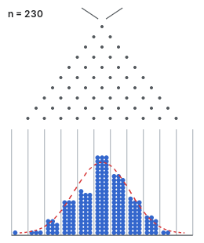

<!--
Vendored, never hotlinked — see CLAUDE.md on site assets.
Source: Wikimedia Commons, File:Planche de Galton animation.gif ("Global Donald"),
260x310, 144 frames, 10 s loop, 344 KB, generated with Python. CC0 1.0, so no
attribution is required; recorded here so the file's provenance is not a mystery.
-->
{fig-alt="A Galton board in motion: balls drop through a triangular array of pegs and stack up in bins beneath, the column heights converging on the dashed normal curve drawn over them."}

A case earns a post when the obvious analysis and the correct one disagree.
Each one states the modelling decision, shows what it cost, and shows what the
alternative would have produced on the same data.
